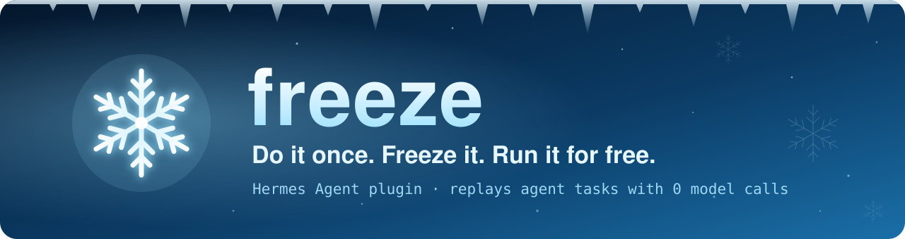
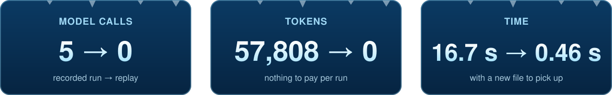
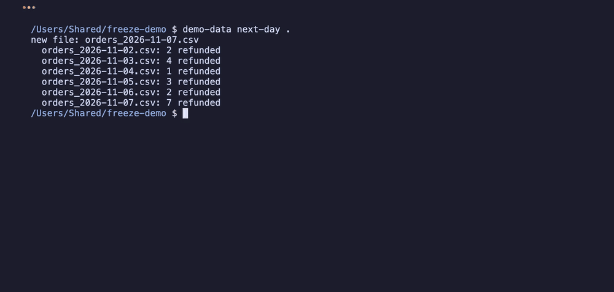
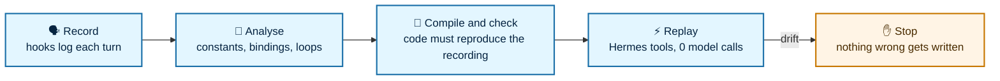

<p align="center">
  
</p>

<p align="center">
  <a href="https://github.com/mauricemohr88-debug/hermes-freeze/actions/workflows/tests.yml"></a>
  
  
  
  <a href="LICENSE"></a>
</p>

<p align="center"><b>Let Hermes do a task once, then replay it without the model.</b></p>

<p align="center">
  
</p>

<p align="center">
  
  <br>
  <sub>Next morning a new CSV has arrived: the replay picks it up and gets the right answer with 0 model calls.
  <a href="https://github.com/mauricemohr88-debug/hermes-freeze/releases/download/v0.1.0/freeze-demo.mp4">Full demo video (84 s)</a></sub>
</p>

Recurring agent tasks pay for the same reasoning every time. Freeze keeps the parts that need
reasoning out of the loop: the model works the task out once, and every later run is the same
tool calls on fresh data.

```
you:     Read each CSV in ./data, count the refunded rows, write refunds.md, tell me the worst day.
hermes:  … (5 model calls, 57,808 tokens, 16.7 s)
you:     /freeze refunds
hermes:  Frozen "refunds": 7 steps, replays with 0 model calls.

$ hermes freeze run refunds          # next morning, a new CSV has arrived
• s2 read_file × 6 (recording had 5)
November 7, 2026 had the most refunds: 7.
✓ Replayed 7 steps, 11 tool calls, 0 model calls, 0.46 s
```

## 🧊 Install

```bash
hermes plugins install https://github.com/mauricemohr88-debug/hermes-freeze
hermes plugins enable freeze
```

Then, in a chat, let Hermes do a task and type `/freeze <name>`. To try it on sample data, see
[demo/DEMO.md](demo/DEMO.md).

## ❄️ How it works



1. **Record.** Hooks write each turn's tool calls, results, the task and the final answer to a
   local database.
2. **Analyse.** `/freeze <name>` classifies every tool argument:
   - **constants:** what you asked for, or what the model chose;
   - **bindings:** a path or ID taken from an earlier result (`{{s1.files[0]}}`);
   - **templates:** earlier results spliced into fixed text (`cat {{s1.files[0]}}`);
   - **loops:** calls that walked a whole list become one `foreach`, so new items are picked up.
3. **Compile and check.** Values the model worked out in its head, such as a report's numbers or
   the final answer, are compiled into a small Python function with one model call each. A
   function is kept only if it reproduces the recorded value exactly, and only if it does not
   spell out data from the results. Otherwise the model gets the difference and tries again, up
   to 3 times.
4. **Replay.** `hermes freeze run <name>` calls Hermes' own tools through `ctx.dispatch_tool`,
   runs the compiled steps in a separate restricted Python process and makes no model calls.

## ⌨️ Commands

| | |
|---|---|
| `/freeze <name> [--turns N]` | Freeze the last task (or the last N turns) of this chat |
| `/freeze list` · `show <name>` · `run <name>` · `delete <name>` | The same commands, from a chat |
| `hermes freeze run <name> [--dry-run] [--fallback agent] [--json] [--quiet]` | Replay |
| `hermes freeze schedule <name> "0 9 * * *" [--fallback agent] [--deliver …]` | Create a no-agent cron job for it |
| `hermes freeze list` · `show <name> [--code]` · `delete <name>` | Manage workflows |

## 🛡️ Safety: Freeze does not guess

- **Missing data.** If the agent's output depends on data its tool calls never returned, `/freeze`
  refuses and names the missing items. In testing, `gpt-4.1` once counted 3 of 5 files, made up
  the other two numbers and claimed it had read them all; Freeze caught it.
- **Drift.** The run stops at the first sign that the world changed shape, and nothing after
  that step runs. Drift means any of these:
  - a tool error;
  - an exit code other than the recorded one (if a command already failed when you froze it,
    `/freeze` points that out, and replays accept only that same code);
  - a list that is empty now;
  - a reference that no longer resolves;
  - a field the compiled code read when you froze it, also inside JSON a command printed, that
    is now missing or has another type, even if the code has a fallback for it (fields some
    items already lacked count as optional);
  - a lookup by a key from the data, such as a file name in a table of counts, that found an
    entry every time when you froze it and finds none now, so the code would fall back to a
    default;
  - a compiled step that fails;
  - an output file someone edited since Freeze last wrote it.

  `--fallback agent` hands the original task to the agent instead. Scheduled jobs only do that
  when created with `hermes freeze schedule … --fallback agent`; by default they report the
  drift and stop, so they never make model calls.
- **Shell commands.** Commands are fixed when you freeze them. Only plain tokens such as paths
  and IDs can vary: no spaces, quotes or shell syntax, and no leading `-`. Write paths taken from
  results must stay inside the workflow's folder.
- **Approvals.** Freeze never approves anything itself. When you run `hermes freeze run` in a
  terminal, a command Hermes flags as dangerous gets Hermes' normal approval prompt. In `smart`
  mode, Hermes' guardian model may answer it first; that is Hermes' own model call, not
  Freeze's. Scheduled runs, `--quiet`, `--json` and `/freeze run` are unattended (cron)
  sessions: they follow `approvals.cron_mode`, which defaults to `deny`. A denied or blocked
  command stops the replay.
- **Your files.** A replay overwrites an existing file only if it still holds exactly what
  Freeze wrote there, in the recording or the last replay. Freeze reads it through Hermes'
  `read_file` first, so Hermes' stale-write guard sees what it replaces. If you edited the file
  in between, the run stops and leaves it alone.
- **Compiled code.** It runs on every replay, scheduled ones included, without asking, so it is
  limited to pure data work. A static check runs first. It refuses:
  - imports outside a small list of data modules, and in `posixpath`, `io` and `string` every
    function not on a short list (no `posixpath.exists`, `io.open`, `string.Formatter`);
  - dunder access, and attribute names that lead to the OS, the interpreter or stack frames
    (`os`, `sys`, `environ`, `system`, `gi_frame`, `f_globals`, …);
  - `open`, `eval`, `exec`, `getattr`, `operator.attrgetter` and `methodcaller`.

  The code then runs in a separate `python -I` process whose environment holds only `PATH` (no API keys),
  a 10-second timeout and no access to the tools or the plugin. Modules reach it only through a
  view that hands out the listed functions and no submodules, so `posixpath.os` fails there too.
  This is defence in depth, not a hard sandbox. `hermes freeze show <name> --code` shows the
  code.

## 🔍 Disclosure

- **Recording.** `pre_llm_call`, `post_tool_call`, `post_api_request` and `post_llm_call` hooks
  store every turn's task text, tool arguments, tool results (truncated at 256 KB), final answer
  and token counts. They go in `<HERMES_HOME>/plugin-data/freeze/data.db`. Recordings older than
  14 days are deleted when the plugin loads and again at most once an hour while turns are
  recorded, so a gateway that runs for weeks keeps pruning. Results may contain whatever the
  tools returned, so treat the folder like your session history.
- **Model calls.** `/freeze` makes model calls through `ctx.llm` (your active model): one per
  compiled step, at most 3 attempts each. It sends the task, the recorded tool results (shortened)
  and the recorded value. Replays make no model calls; `--fallback agent` starts a normal
  `hermes chat` run.
- **Processes and files.** A replay runs the frozen tool calls with Hermes' tools: shell commands
  and file writes as recorded. It runs compiled steps in a child Python process. `/freeze run`
  starts `hermes freeze run` as a child process.
- **State.** `<HERMES_HOME>/plugin-data/freeze/written/<name>.json` keeps a SHA-256 hash of each
  file a workflow wrote, for the overwrite check above.
- **Scheduling.** `hermes freeze schedule` writes `<HERMES_HOME>/scripts/freeze-<name>.sh` and
  creates a cron job with `hermes cron create --no-agent`. The script runs
  `hermes freeze run <name> --quiet`: 0 model calls, and drift is reported, not retried. Only a
  job created with `--fallback agent` starts `hermes chat` on drift, and that run costs model
  calls. Jobs created with 0.1.4 or earlier still have the fallback; run `schedule` again (and
  remove the old job) to drop it.
- **What it does not do.** No network calls of its own, no telemetry, no credentials.

## 🚧 Limits

- Freeze catches structural drift, not every change in meaning. A field that keeps its name but
  changes what it means goes unnoticed, for example an amount that switches from cents to dollars.
  If a CSV column is renamed and a command quietly prints 0, the replay reports 0.
- Freeze does not know what success means for your task. Skipped tests or a result that is
  plausible but wrong are not detected unless they change the exit code or the data's shape.
- Positional bindings (`files[0]`) depend on the order a tool returns. Whole-list loops do not.
- When the agent solves a task with an inline script (`python -c`, a heredoc), Hermes flags that
  command, so the workflow needs approval on every run and cannot be scheduled while
  `approvals.cron_mode` is `deny`. `/freeze` says so. Asking Hermes to use its file tools gives a
  workflow that runs unattended, and its loops pick up new files.
- MCP tools and tools that need the model or a person (`clarify`, `delegate_task`, `memory`, …)
  are left out of a workflow. Browser sessions are not supported yet.
- Needs Hermes 0.23.0 or later.
- Under `plugins.isolation: host`, Hermes does not wire plugin CLI subcommands, so
  `hermes freeze …` (and with it `/freeze run` and scheduling) is unavailable there. Use the
  default, `plugins.isolation: in_process`.

## 🛠️ Development

```bash
python3 -m unittest discover -s tests      # 62 tests, no Hermes needed
hermes plugins doctor . --ci
hermes plugins validate .
```

## 📄 License

MIT
